<a href="https://fryderykpryjma.com">
  <picture>
    <source media="(prefers-color-scheme: dark)" srcset="assets/hero-dark.svg">
    
  </picture>
</a>

  
  
  
  

## What I'm building

Co-founder & CEO of **CortexMine**. We build private AI that runs on-prem or in private cloud, for companies that can't send sensitive data to public AI: manufacturing, chemicals, energy and critical infrastructure in Poland and DACH.

CortexMine gives teams source-grounded answers and AI workers inside real workflows (audit, technical documentation, service, work instructions), with access control and an audit trail.

<picture>
  <source media="(prefers-color-scheme: dark)" srcset="assets/demo-dark.svg">
  
</picture>

Illustrative example. Every answer points to its sources, respects who is asking, and lands in the audit trail.

<b>Why on-prem?</b>

 

- **The know-how stays in the plant.** Work instructions, audit findings and service reports never leave your network or your private cloud.
- **Access follows your roles.** A technician gets the answers a technician is allowed to see, nothing more.
- **Answers can be checked.** Each one links to the source document and is logged, so quality and compliance teams can see where it came from.

## Background

- Former COO of a 60-person software house, then CEO of its spin-off
- BSc and MSc from Tampere University (Human-Technology Interaction)
- MBA, PhD candidate in knowledge transfer (Akademia WSB)

## Latest writing

<!-- BLOG:START -->
- [AI Won't Moderate Your User Interview (Yet) — But It Transforms the Prep](https://fryderykpryjma.com/en/blog/ai-moderated-ux-research-reality/) · Jul 2026
- [Software Is Knowledge Transfer First, Code Second](https://fryderykpryjma.com/en/blog/software-is-knowledge-transfer-first-code-second/) · Jul 2026
- [Knowledge Transfer in Software Development Discovery](https://fryderykpryjma.com/en/blog/knowledge-transfer-in-software-development-discovery/) · Dec 2025
- [Start in industrial PhD journey](https://fryderykpryjma.com/en/blog/start-in-industrial-phd-journey/) · Nov 2025
<!-- BLOG:END -->

Synced daily from <a href="https://fryderykpryjma.com/en/blog/">fryderykpryjma.com</a> by a GitHub Action.

---

  <picture>
    <source media="(prefers-color-scheme: dark)" srcset="assets/fp-sygnet-dark.svg">
    
  </picture>
   
  Kraków, Poland

